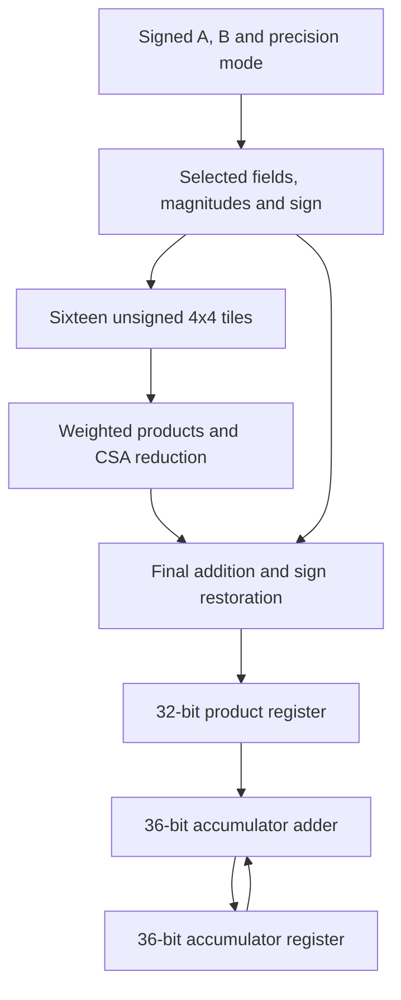

# Target architecture

The target is a fixed 16x16 systolic array with 256 PEs. Each PE will compute a
dot-product contribution, forward A to the right and B downwards, and retain a
local accumulated result. Signed operand precision is selectable as INT4/8/16.

The implemented hardware currently consists of the two unsigned 4x4 tile
candidates. The shared multiplier and PE below are the planned integration.

## One PE's planned arithmetic

The extra decoder-to-product path represents the remembered sign. Pipeline
implementation must keep sign, data and valid information aligned. Operand
forwarding registers and stream control are additional parts of the PE.

## Precision and tile selection

| Mode | Selected signed input | Active tile grid | Active tiles |
| --- | --- | --- | --- |
| `00` | Low 4 bits | 1x1 | 1 |
| `01` | Low 8 bits | 2x2 | 4 |
| `10` | All 16 bits | 4x4 | 16 |
| `11` | Reserved | Inactive | 0 |

This grid is inside one PE. It is separate from the 16x16 array of PEs.
Inactive tile inputs will be held constant through operand isolation. This
reduces data-dependent switching; the physical cells remain present.

## Signed multiplication

Interpret the selected signed fields before splitting their magnitudes into
chunks. Remember `sign_A XOR sign_B`. Magnitudes are unsigned, allowing 8, 128
and 32768 to represent the absolute values of the signed minima.

For chunk indices i and j, align the unsigned tile product at bit position
`4*(i+j)`. Widen the 8-bit product before shifting. Combine all required terms,
then restore the sign using two's-complement negation of the full product.

The HSM odd/even correction inside a tile is separate from whole-product sign
restoration. Both BASIC and HSM tiles can use the same surrounding signed logic.

## Addition and accumulation

The target diagram uses CSA reduction for weighted tile products. Explicit
carry-save logic will reduce multiple operands to two rows; carry-propagating
addition is needed to produce an ordinary binary result. A chain or balanced
tree of `+` expressions alone does not specify the same reduction structure.

| Operand precision | Complete product width | Signed accumulator width for 16 terms |
| --- | --- | --- |
| INT4 | 8 bits | 12 bits |
| INT8 | 16 bits | 20 bits |
| INT16 | 32 bits | 36 bits |

The accumulator widths assume at most sixteen products accumulated from zero.
Use sign extension when widening a signed product. Precision-controlled adder
sections must preserve carries and sign reconstruction. That control is a
separate implementation task from disabling unused multiplier tiles.

Register enables and correctly aligned valid/control signals will be verified
before introducing further clock-gating optimizations. Keep precision fixed
during a matrix operation and define clear/reset behavior before the next one.

## Literature studied

The [HSM patent US7873823B2](https://patents.google.com/patent/US7873823B2/en)
motivates the square-based tile. The small RTL lookup tables describe constant
functions and may map into gates. Published results for other widths, memories
or flows are not measurements of this implementation.
